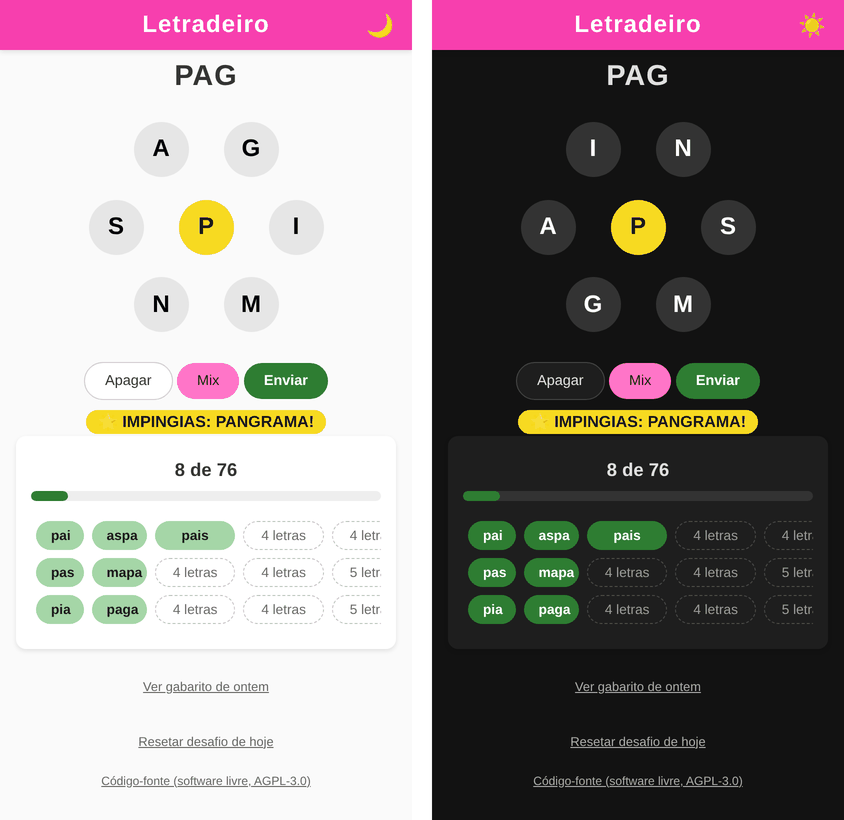

# Letradeiro

Jogo diário de formar palavras com 7 letras, uma delas obrigatória (a chave).
Todo dia, à meia-noite de Brasília, um novo desafio é sorteado.



## Como jogar

- Forme palavras de **3 letras ou mais** usando as letras da roda.
- Toda palavra precisa ter a **letra central** (a amarela). Letras podem se repetir.
- Um **pangrama** usa as 7 letras e ganha confetes. 🌟
- No computador, dá para jogar pelo **teclado**: digite as letras (acentos são ignorados), `Enter` envia, `Backspace` apaga, `Esc` fecha as telas sobrepostas.

## Estrutura

```
letradeiro/
├── index.html, script.js, styles.css   front-end do jogo
├── favicon.svg      ícone da aba
├── vendor/          bibliotecas de terceiros (canvas-confetti), servidas localmente
├── docs/            imagens do README (não vão para o servidor)
├── get.php          entrega o desafio de hoje (e o gabarito de ontem)
├── generate.php     gera o desafio pelo terminal (usado pelo agendador)
├── reset.php        sorteia um novo desafio de hoje (pede senha)
├── inc/
│   ├── desafio.php          toda a lógica de sorteio e cache
│   ├── config.exemplo.php   modelo da configuração
│   └── config.php           senha (hash); NÃO vai para o git
├── sistema/
│   ├── letradeiro-gerar.service   o que rodar (systemd)
│   └── letradeiro-gerar.timer     quando rodar (systemd)
├── data/            desafios gerados, um JSON por dia
├── deploy.sh             envia os arquivos para o servidor
├── deploy.conf.exemplo   modelo dos dados do servidor
├── deploy.conf           seus dados do servidor; NÃO vai para o git
└── LICENSE               texto da licença AGPL-3.0
```

## Requisitos

- PHP 8.1 ou mais novo, com a extensão `mbstring`
- Dicionário `/usr/share/dict/brazilian` (no Debian/Ubuntu: `sudo apt install wbrazilian`)
- systemd (para o agendador; há alternativa com cron)
- `rsync` e `ssh` no seu computador, para o deploy

## Como funciona

1. À **0h00min05s** (horário de Brasília), o agendador do systemd roda o `generate.php`.
2. Ele sorteia as letras até achar um conjunto com 30 a 200 palavras e pelo menos um pangrama, e grava `data/challenge_AAAA-MM-DD.json`.
3. Quando alguém abre o jogo, o `get.php` só **lê** esse arquivo. Resposta instantânea.

**Rede de segurança:** se o arquivo do dia não existir (servidor desligado à meia-noite, agendador quebrado), o `get.php` gera na hora. Um mutex (`flock`) garante que, mesmo com várias pessoas abrindo o jogo ao mesmo tempo, só um processo sorteia e todos recebem o mesmo desafio.

**Reset:** o botão "Resetar desafio de hoje" chama o `reset.php`, que sorteia um novo desafio na hora e substitui o atual.

---

## Instalação no servidor

Faça um passo de cada vez. Os comandos marcados com 🖥️ rodam no **servidor**; os marcados com 💻, no **seu computador**.

> 📁 Os exemplos usam a pasta `/var/www/letradeiro`. Se a sua for outra, troque nos comandos abaixo e nas duas linhas marcadas com `AJUSTE` em `sistema/letradeiro-gerar.service`.

### Passo 1: configurar o deploy 💻

Na pasta do projeto, crie o arquivo com os dados do seu servidor (só na primeira vez):

```bash
cp deploy.conf.exemplo deploy.conf
nano deploy.conf
```

Preencha usuário SSH, endereço do servidor e pasta do jogo. Salve (`Ctrl+O`, `Enter`, `Ctrl+X`).

### Passo 2: enviar os arquivos 💻

```bash
./deploy.sh
```

O deploy faz duas coisas:

- manda os arquivos do jogo para a pasta pública do site (sem `data/`, `docs/`, `sistema/` nem o README);
- manda a pasta `sistema/` para `/tmp/letradeiro-sistema/` no servidor, **fora** da pasta pública. O Passo 5 usa esses arquivos.

### Passo 3: criar a senha do reset 🖥️

Entre na pasta do jogo:

```bash
cd /var/www/letradeiro
```

Gere o hash da senha (digite a senha e aperte Enter; ela aparece na tela, mas não fica no histórico do bash):

```bash
php -r 'echo "Senha: "; echo password_hash(trim(fgets(STDIN)), PASSWORD_DEFAULT), PHP_EOL;'
```

Copie a linha que começa com `$2y$`. Crie o arquivo de configuração a partir do modelo:

```bash
cp inc/config.exemplo.php inc/config.php
nano inc/config.php
```

Troque `COLE_O_HASH_AQUI` pelo hash copiado, **mantendo as aspas simples**. Salve (`Ctrl+O`, `Enter`, `Ctrl+X`).

> 💡 Use uma senha de verdade, não um PIN de 4 dígitos: 4 dígitos são só 10 mil possibilidades.

### Passo 4: testar o gerador na mão 🖥️

Rode como `www-data`, o mesmo usuário que o agendador vai usar:

```bash
sudo -u www-data php /var/www/letradeiro/generate.php
```

Esperado: algo como

```
[2026-10-24] Desafio já existia, mantido: letras T L X V I O A (chave T), 80 palavras, 0 ms
```

Se der erro de permissão, confira se a pasta `data/` pertence a `www-data`.

### Passo 5: instalar no systemd 🖥️

O `deploy.sh` já deixou os arquivos em `/tmp/letradeiro-sistema/`:

```bash
sudo cp /tmp/letradeiro-sistema/letradeiro-gerar.service /tmp/letradeiro-sistema/letradeiro-gerar.timer /etc/systemd/system/
```

> ⚠️ **Se o jogo NÃO está em `/var/www/letradeiro`**, ajuste o caminho no serviço instalado, senão o agendador falha sem avisar. Exemplo para quem instalou em `/var/www/meusite/letradeiro`:
>
> ```bash
> sudo sed -i 's|/var/www/letradeiro|/var/www/meusite/letradeiro|g' /etc/systemd/system/letradeiro-gerar.service
> ```
>
> Confira com `grep letradeiro /etc/systemd/system/letradeiro-gerar.service`: as duas linhas devem mostrar a sua pasta. Repita esse ajuste toda vez que copiar o `.service` de novo.

### Passo 6: conferir se o systemd entende o horário 🖥️

```bash
systemd-analyze calendar '*-*-* 00:00:05 America/Sao_Paulo'
```

Esperado: uma saída com `Next elapse:` mostrando a próxima meia-noite. Se der erro, veja a seção [Alternativa com cron](#alternativa-com-cron).

### Passo 7: avisar o systemd e ligar o agendador 🖥️

```bash
sudo systemctl daemon-reload
sudo systemctl enable --now letradeiro-gerar.timer
```

O `enable` faz o agendador sobreviver a reinicializações; o `--now` já o liga.

### Passo 8: confirmar que está agendado 🖥️

```bash
systemctl list-timers letradeiro-gerar.timer
```

Esperado: uma linha com a próxima execução (coluna `NEXT`) à meia-noite.

### Passo 9: disparar uma vez para testar 🖥️

```bash
sudo systemctl start letradeiro-gerar.service
sudo journalctl -u letradeiro-gerar.service -n 5 --no-pager
```

No log deve aparecer a linha `Desafio ... mantido` (ou `gerado`). Pronto, está instalado.

---

## Uso no dia a dia

| Quero... | Comando (no servidor) |
|---|---|
| Ver quando roda de novo | `systemctl list-timers letradeiro-gerar.timer` |
| Ver o que aconteceu nas últimas noites | `sudo journalctl -u letradeiro-gerar.service --since "3 days ago" --no-pager` |
| Sortear outro desafio para hoje | `sudo -u www-data php /var/www/letradeiro/generate.php --forcar` |
| Ver erros do get/reset | `sudo grep Letradeiro /var/log/nginx/error.log \| tail` |
| Desligar o agendador | `sudo systemctl disable --now letradeiro-gerar.timer` |

Se mudar algo nos arquivos `.service` ou `.timer`: rode o `./deploy.sh`, repita o Passo 5 e depois `sudo systemctl daemon-reload`.

---

## Por que systemd timer, e não cron?

- **Fuso horário explícito:** o `America/Sao_Paulo` no `OnCalendar` garante meia-noite de Brasília, seja qual for o fuso do servidor. No cron do Debian, o horário segue o fuso do sistema.
- **`Persistent=true`:** se o servidor estava desligado à meia-noite, a geração roda assim que ele ligar.
- **Log de graça:** toda saída vai para o `journalctl`, com data e hora.

## Alternativa com cron

Se o Passo 6 falhar (systemd muito antigo), use o cron. Primeiro descubra o fuso do servidor:

```bash
timedatectl | grep "Time zone"
```

- Se for `America/Sao_Paulo`, a meia-noite do cron é a de Brasília: use `0 0 * * *`.
- Se for `UTC`, a meia-noite de Brasília é às **3h UTC**: use `0 3 * * *`.

Edite o crontab do `www-data`:

```bash
sudo crontab -u www-data -e
```

E adicione (exemplo para servidor em UTC):

```
0 3 * * * /usr/bin/php /var/www/letradeiro/generate.php >> /tmp/letradeiro-gerar.log 2>&1
```

> ⚠️ Se um dia o Brasil voltar a ter horário de verão, a linha do cron precisa ser ajustada à mão. O timer do systemd se ajusta sozinho.

---

## Segurança (recomendado)

O `inc/` só define funções e a constante com o hash, então acessá-lo pelo navegador não mostra nada. Mesmo assim, é boa prática fechar a porta. No arquivo do seu site em `/etc/nginx/sites-available/`, dentro do bloco `server { }` do HTTPS e **antes** do `location ~ \.php$` (ajuste `/letradeiro/` se o jogo estiver em outro caminho):

```nginx
location ~ ^/letradeiro/inc/ {
    return 404;
}
```

Depois: `sudo nginx -t && sudo systemctl reload nginx`.

---

## Detalhes técnicos

- **Mutex:** `garantirDesafio()` usa `flock` em `data/.letradeiro.lock`. Quem chega durante um sorteio espera e, ao entrar, confere de novo se o arquivo já existe antes de sortear.
- **Escrita atômica:** o JSON é gravado num temporário e renomeado. Ninguém nunca lê um arquivo pela metade.
- **`id` do desafio:** é o md5 de data, chave e letras. Assim, as mesmas letras em outro dia (ou com outra chave) não herdam o progresso salvo no navegador. Desafios antigos mantêm o formato de id anterior; nada quebra na transição.
- **Dicionário:** `/usr/share/dict/brazilian` (pacote `wbrazilian`). Lido uma vez por sorteio e filtrado em memória com `preg_grep`.
- **Tempo de geração:** de 0,2 a 0,4 s nos testes.
- **Acessibilidade:** todas as combinações de cor de texto e fundo passam no contraste mínimo da WCAG nos dois temas; as letras da roda são botões de verdade (funcionam com leitor de tela e teclado); quem configura o sistema para reduzir movimento não recebe confetes nem animações.
- **Tema:** na primeira visita segue o do sistema (claro ou escuro); depois, vale a escolha feita no botão 🌙/☀️.
- **Sem dependências externas em tempo de execução:** a biblioteca de confetes é servida pelo próprio servidor, não por um CDN.

## Software de terceiros

- [canvas-confetti](https://github.com/catdad/canvas-confetti) 1.6.0, de Kiril Vatev, licença ISC. Cópia em `vendor/confetti.browser.js`; licença em `vendor/LICENSE-canvas-confetti`.

---

## Sobre o desenvolvimento

O Letradeiro foi desenvolvido por Saulo Popov Zambiasi com auxílio de inteligência artificial: o **Gemini** (Google) e o **Claude** (Anthropic) participaram da escrita e da revisão do código. As decisões de projeto, os testes e a curadoria final são humanos.

A mecânica de formar palavras a partir de um conjunto de letras com uma letra obrigatória é um formato conhecido de jogos de palavras; o código, o visual e o nome são próprios deste projeto.

## Licença

Copyright (C) 2026 Saulo Popov Zambiasi

Este programa é software livre: você pode redistribuí-lo e/ou modificá-lo sob os termos da **GNU Affero General Public License**, publicada pela Free Software Foundation, versão 3 da licença ou (a seu critério) qualquer versão posterior.

Em resumo: você pode usar, estudar, modificar e compartilhar. Se modificar o Letradeiro **e disponibilizá-lo para outras pessoas usarem pela rede** (por exemplo, hospedando o jogo num site), precisa oferecer a essas pessoas o código-fonte da sua versão, sob a mesma licença.

Este programa é distribuído na esperança de ser útil, mas SEM NENHUMA GARANTIA. Veja o texto completo no arquivo [`LICENSE`](LICENSE).
